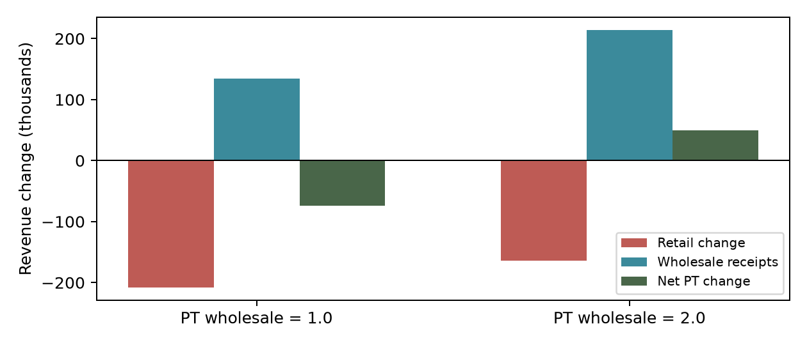
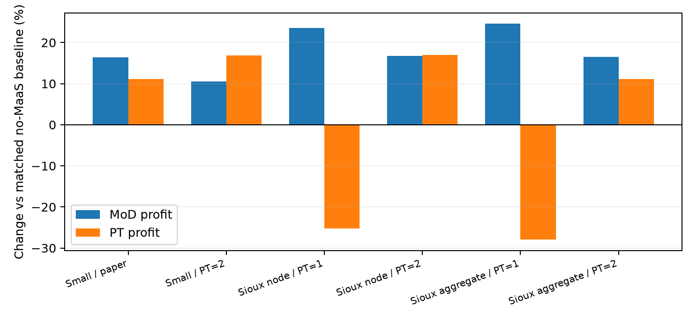

# MaaS 최종 재현 V6

## MaaS 최종 재현 V6 | 결론과 사용 범위

2026-10-27 · 2026-12-03 EPFL group meeting 논문 리뷰용 · 16개 제한 실험

최종 판정: 조건부 경제적 메커니즘은 재현했습니다. 원 논문과 같은 도매단가에서 Sioux Falls의 상생 결과와 Tables 2-3의 수치를 정밀하게 재현한 것은 아닙니다. 이 경계를 명시하고, 이번 버전을 후속 연구를 위한 재현 기준선으로 확정합니다.

| 검증된 조건 | MoD 수익 변화 | PT 수익 변화 | MaaS 이익 | 총 이용자 후생 |
| --- | --- | --- | --- | --- |
| Small, 논문 도매값 | +16.34% | +11.16% | 152 | 개선 |
| Small, PT=2 | +10.48% | +16.90% | 101 | 개선 |
| Sioux node, PT=1 | +23.56% | -25.22% | 135,707 | 개선 |
| Sioux node, PT=2 | +16.70% | +17.00% | 94,514 | 개선 |
| Sioux aggregate, PT=1 | +24.56% | -27.98% | 115,968 | 개선 |
| Sioux aggregate, PT=2 | +16.46% | +11.09% | 80,887 | 개선 |

node는 MoD/PT 접근 수요를 노드별로 집계한 설정입니다. aggregate는 MoD만 전체 집계하고 PT는 노드별인 대조 설정입니다. 본문의 문자적 MoD 해석은 aggregate가 우선이며, node 결과가 더 가깝다는 이유로 저자의 설정이라고 주장하지 않습니다.

PT 도매단가 2에서 Sioux Falls의 상생 방향은 두 접근 수요 설정 모두에서 유지됐습니다. 반면 원 논문 PT 도매단가 1에서는 두 설정 모두 PT 수익이 감소했습니다. 수익 감소를 제거하도록 숨은 보정을 하지 않았습니다.

16개 최종 상태 모두 명시된 수치·가격 이탈·회계·비용 검증을 통과했습니다. PASS는 이 검사 범위의 통과이며 전역 균형, 유일성 또는 저자 설정의 복원을 의미하지 않습니다.

총 후생과 개별 편익은 다릅니다. Sioux node, PT=2에서는 14개 OD의 평균 기대효용이 소폭 감소하며 해당 OD의 수요 비중은 1.72%입니다. 모든 개인의 Pareto 개선이라고 발표하면 안 됩니다.

## 1. 모형의 작동 원리와 재현한 부분

여행자는 non-MaaS, driving, MaaS 중 서비스 체계를 선택하고, 그 안에서 확률적 경로 선택을 합니다. 플랫폼은 OD별 요금을 정하고 실제 이용한 서비스 용량에 도매대금을 지급합니다. 운영자는 소매가격을 정하면서 소매수입과 도매수입을 함께 고려합니다.

선택모형: Shannon 특수화

V_i = θ log Σ_j exp[(-C_ij + V_j)/θ], 목적지 V=0. 이 가치함수에서 전이확률과 기대 간선 흐름을 구합니다. 경로를 최단경로 하나로 제한하지 않고 희소 선형계로 확률적 적재와 민감도를 계산합니다. 이번 실험은 경로 및 루트 선택 척도를 모두 1로 고정했습니다. 이는 저자의 실제 실험 척도를 알아냈다는 뜻이 아닙니다.

시장균형: 가상 교통 운영자와 VI

y=(시간 t, MaaS 요금 p, 운영자 가격 r), H(y)=(공급-흐름, -플랫폼 이익기울기, -운영자 이익기울기). VI는 H(y*)·(y-y*) ≥ 0을 만족하는 상태를 찾습니다. 내부 가격에서는 한계이익이 0이고, 용량 자원에서는 여유 용량과 그림자 지체가 상보적으로 작동합니다.

가상 운영자는 시간·흐름 일치 조건을 같은 VI에 넣습니다. 각 가격 평가 안에서 전체 혼잡균형을 다시 푸는 중첩 계산을 피하지만, 매 H 평가의 여행자 선택·흐름·민감도 계산은 여전히 필요합니다.

PT 최적가격 조건과 도입 전후 비교는 다른 질문

고정된 t, 경쟁 가격, 플랫폼 요금에서: dΠ_PT/dr = B + r·dB/dr + c_PT·dW/dr. B는 소매 유료 PT 간선량, W는 MaaS PT 간선량입니다. 도매 항을 빼면 가격 최적조건 자체가 달라집니다.

도입 전후에는 ΔΠ_PT = (소매수입_after - 소매수입_before) + 도매수입_after 입니다. 이 회계 분해는 새 균형끼리 비교한 결과이고, 다른 조건을 고정한 가격 미분과 혼동하면 안 됩니다.

최종 해는 원 논문의 extragradient 궤적이 아닌 보조 root/least-squares 해법으로 계산했습니다. 수렴과 해 존재, 유일성은 별개의 주장입니다. 자세한 수식 해설과 발표 질문은 notes/V6_METHOD_REVIEW.md에 정리했습니다.

## 2. 원 논문과의 비교: 맞은 방향과 남은 차이

| Sioux Falls | MoD 수익 | PT 수익 | MaaS 이익 | 자가용 % | PT 가격 |
| --- | --- | --- | --- | --- | --- |
| 논문: 미도입 | 221,756 | 337,286 | - | 48.50 | 3.65 |
| 논문: 도입 | 376,355 | 375,636 | 5,658 | 40.30 | 2.42 |
| V6 node: 미도입 | 227,626 | 292,167 | 0 | 44.70 | 2.60 |
| V6 node: PT=1 | 281,250 | 218,469 | 135,707 | 41.93 | 1.72 |
| V6 node: PT=2 | 265,635 | 341,836 | 94,514 | 42.72 | 2.45 |

| 작은 네트워크 | MoD 수익 | PT 수익 | MaaS 이익 | 자가용 % | PT 가격 |
| --- | --- | --- | --- | --- | --- |
| 논문: 미도입 | 1,176.7 | 664.1 | - | 23.70 | 1.38 |
| 논문: 도입 (10%) | 1,278.1 | 678.6 | 232.9 | 22.50 | 1.44 |
| V6: 미도입 | 569.9 | 486.1 | 0.0 | 21.37 | 0.82 |
| V6: 논문 도매값 | 663.1 | 540.4 | 152.2 | 20.15 | 0.84 |
| V6: PT=2 | 629.7 | 568.3 | 101.2 | 20.53 | 0.85 |

출처: 제공 원 논문 Table 2의 환승 페널티 10% 열과 Table 3. 두 표의 금액·시간·효용 단위를 그대로 비교하되, 선택 척도와 세부 집계 정의가 완전히 식별되지 않았다는 한계를 유지합니다.

작은 네트워크에서는 원 논문 도매값에서도 두 운영자 수익 증가, 양의 플랫폼 이익, 자가용 비중 감소, 이용자 후생 증가가 함께 나타납니다. 그러나 절대 가격·수익 수준은 다릅니다. Sioux Falls에서는 PT=2에서 주요 편익 방향을 회복하지만 플랫폼 이익과 MaaS 점유율 차이는 여전히 큽니다.

네트워크별 임의 보정은 하지 않았습니다. 각 네트워크의 기존 논문 기반 기본값을 유지했고, 비교 도매값과 비용 진단만 사전에 지정했습니다. 특히 small의 MoD 도매값은 1.3, Sioux의 MoD 도매값은 1.5로 고정했습니다.

환승량은 원 표와의 단위·집계가 미확정이므로 절대값의 일치를 주장하지 않습니다. PT 첫 탑승 비중, PT 간선 이용량, MaaS 모드 비중도 별개로 내보냈습니다.

## 3. 왜 PT 수익이 줄고, 언제 보상되는가

| Sioux node | 소매수입 변화 | 도매수입 증가 | 순 PT 수익 변화 |
| --- | --- | --- | --- |
| PT 도매 1 | -207,640 | 133,942 | -73,698 |
| PT 도매 2 | -164,241 | 213,911 | 49,670 |

도매 1에서는 도매 지급이 누락된 것이 아니라, 기존 PT 소매수입 감소를 도매수입이 충분히 메우지 못합니다. 도매 2에서는 플랫폼 수익이 줄어드는 대신 운영자에게 돌아가는 수입이 커져 PT 순증가가 나타납니다. 모든 가격과 시간은 시나리오별로 다시 풀었습니다.

| 지표 | 미도입 | PT 도매 1 | PT 도매 2 |
| --- | --- | --- | --- |
| PT 첫 탑승 합계 (%) | 14.46 | 16.72 | 15.56 |
| MaaS 내 PT 첫 탑승 (% 전체수요) | - | 9.30 | 7.78 |
| MaaS PT 유료 간선량 | 0 | 133,942 | 106,955 |
| 플랫폼 이익 | 0 | 135,707 | 94,514 |

첫 탑승은 PT 접근 간선에서 분류한 지표입니다. 이후 PT 주행 없이 다른 수단으로 환승하는 경로도 허용되므로 실제 PT 탑승·이용 인원과 완전히 같은 정의가 아닙니다. 도매 2의 더 큰 수입을 무조건 더 큰 PT 이용량으로 해석해서도 안 됩니다.

검증한 도매점은 조건부 상생의 존재를 보여줍니다. 연속적인 상생 구간이나 임계 도매단가를 추정한 것은 아니며, 원 논문의 공통 도매가격 전체 곡선을 복원한 것도 아닙니다.

## 4. 마지막 비용 진단과 환승 편익 대조

| Sioux node 설정 | 미도입 PT 가격 | 미도입 PT 첫 탑승 % | 도입 후 PT 수익 변화 |
| --- | --- | --- | --- |
| 초기 2 / 환승 2 | 2.60 | 14.46 | -25.22% |
| 초기 1 / 환승 2 | 2.82 | 15.38 | -27.88% |
| 초기 2 / 환승 1 | 2.43 | 14.65 | -22.61% |

1은 불확실성을 점검하기 위한 진단값이며 원저자의 값이 아닙니다. 접근 용량은 공유한 채 초기 대기와 환승 접근비용만 분리했습니다. 두 진단 모두 도매 1에서 PT 수익 감소를 없애지 못했습니다. 초기 대기를 낮추면 미도입 PT 비중은 이미 높은 상태에서 더 높아져 전체 불일치를 해결하지 못합니다.

| 환승 페널티 대조 | Sioux 환승량 | Small 환승량 |
| --- | --- | --- |
| MaaS 할인 없음 (8 / 10) | 10,889.40 | 0.029 |
| MaaS 기본 할인 (0.5 / 1) | 60,941.39 | 26.827 |

환승 페널티 감소는 두 네트워크에서 환승량을 증가시켰습니다. 다만 할인 없는 조건에서도 MaaS는 양의 이익과 수요를 가집니다. 서비스 대안 추가, OD별 가격 경쟁, 루트 logsum 효과도 작동하므로 전체 편익을 환승 개선 하나에 귀속할 수 없습니다.

고정 시간의 가격 반응: 기존 V5에서 Sioux 미도입 가격을 2.6015에서 3.65로 올리면 PT 수익은 약 292,167에서 282,901로 감소했고, 3.65에서 기울기는 약 -20,219였습니다. 이는 MaaS 진입 효과와 별개의 검증입니다. V6에서는 대표 OD의 선택 반응을 새로 계산했습니다.

| 대표 OD | 기준가격의 기대 유료 PT 간선수 | 가격 3.65의 기대 유료 PT 간선수 |
| --- | --- | --- |
| 1→3 | 0.014472 | 0.005120 |
| 1→13 | 0.000142 | 0.000007 |
| 1→18 | 0.000003 | 0.000001 |

표는 전체 수요 중 non-MaaS 선택확률까지 곱한 1인당 기대 간선수입니다. 이는 순수 PT 최소비용 경로의 길이나 첫 탑승확률과 다릅니다. 대표 OD를 전체 네트워크의 평균으로 일반화하지 않습니다.

## 5. 수치 검증, 재실행성과 계산 규모

| 검사 | 16개 최종 상태의 최대값 / 결과 |
| --- | --- |
| 자연 VI 잔차 | 1.11e-08 |
| 척도 조정 VI 잔차 | 6.59e-08 |
| 수요 보존 오차 | 2.18e-11 |
| 수익 회계 오차 | 1.75e-10 |
| PT 용량 초과 / 상보성 오차 | 9.35e-05 / 8.32e-05 |
| 검사한 운영자 가격 이탈의 최대 이득 | 1.75e-10 |
| MaaS 조건부 정확 최적 요금의 최대 이득 | 0 |
| 상태 상한 200 / 비용 항등식 | 상한 비활성 / 모든 상태 통과 |

작은 네트워크 3건은 최초 검증에서 용량 상보성의 절대 곱 기준을 넘었습니다. 큰 여유 용량 10^6에 10^-8 수준의 잔여 지체가 곱해진 수치 경계 문제였습니다. 여유 용량이 확실한 자원의 지체를 정확히 0으로 투영하고 요금·잔차·감사를 재계산했습니다. 최대 시간 보정은 2.82×10^-8이며, 경제적 파라미터는 그대로입니다. 최초 실패 상태와 결과도 before_active_set_polish에 보존했습니다.

운영자 가격은 0~10 격자 및 20·50·100·200 후보와 국소 정밀검색으로 검사했습니다. 플랫폼은 현 특수화의 조건부 최적 요금과 표본 유한차분으로 검사했습니다. 전역 최적성이나 복수 시작점의 동일 수렴을 증명한 것은 아닙니다.

| 로컬 계산 | OD / 목적지 | 희소 그래프 수 | H 평가 중앙값 | 보조 solve 시간 |
| --- | --- | --- | --- | --- |
| small | 3 / 2 | 6 | 5.41 ms | 21.56 s |
| sioux | 528 / 24 | 72 | 72.07 ms | 9.04 s |

H 평가는 계산 종료 후 각 3회 측정했고 BLAS 스레드 1을 요청했습니다. solve는 기존 상태에서 가격을 교란한 warm start입니다. 작은 네트워크는 bounded least-squares, Sioux는 Krylov root를 사용하므로 solve 시간의 역전을 규모 우위로 해석하지 않습니다. 대도시 네트워크 성능이나 병렬 가속을 입증하는 수치는 아닙니다.

528 OD를 24개 목적지로 묶어 희소 분해를 재사용하는 것이 현재 구현의 계산상 이점입니다. 행동집단을 늘리면 별도 가치함수와 민감도 계산이 필요할 수 있고, 환승 상태 확장 및 LU fill-in이 메모리 병목이 될 수 있습니다.

## 6. 논문 리뷰에서 제시할 결론과 다음 연구

이번 재현의 발표 문장

“원 논문의 수치 균형을 복원하지는 못했지만, 독립 구현에서 MaaS의 수단 전환, 소매수입 대체와 도매 정산, 도매조건에 따른 운영자·총 이용자 편익의 동시 개선을 확인했다. 그 결론은 수요 명세와 접근 수요 집계에 조건부이며, 총 후생 개선은 모든 OD의 개선을 보장하지 않는다.”

수요 관점: Sioux node PT=2에서 총 이용자 효용은 약 866,734 증가했지만 14개 OD의 기대효용은 감소했습니다. 가장 큰 감소는 약 0.0552이며 이 OD들의 총 수요 비중은 1.72%입니다. 개인별 손해 확률을 관측한 것이 아니라 OD 평균 기대효용을 비교한 결과입니다. 작은 네트워크 PT=2에서는 검사한 3개 OD 모두 개선됐습니다.

방법론 관점: VI 존재와 수렴을 구분하고, 가상 운영자의 역할과 고정 시간 가격 미분을 설명하는 것이 핵심입니다. 보조 해법의 정확도 검증과 원 알고리즘의 경로 재현을 혼동하지 않아야 합니다. 현재 재현의 한계도 명확하게 설명할 수 있는 상태입니다.

다음 단계: 숫자 맞추기 탐색을 종료하고, 동일 네트워크·공급·총 OD 수요에서 평균 환승 불편은 유지하되 집단별 민감도를 달리하는 통제 실험을 설계할 수 있습니다. 연구질문은 이질성의 도입 자체보다 도매조건별 공동 편익과 분배가 어떻게 달라지는가입니다. 이는 제안이며 이번에 수행한 결과가 아닙니다.

자료와 재개: REPRODUCTION_V6.md, notes/V6_METHOD_REVIEW.md, results/v6/manifest.json 및 final_verification.json. campaign_v6.py는 완료 상태를 건너뛰고 중단 계산을 체크포인트에서 재개합니다. polish_v6.py는 경계 보정을 보존·재현합니다. 연결 중단 후 재개는 사용자의 지시를 기다리며 자동 예약하지 않습니다.

원문 근거: Yao, Ma & Zhang (2026), TRC 188, 105703, DOI: 10.1016/j.trc.2026.105703; Sections 3-4, 5.1.4, Tables 2-3, Appendix A. 상세 가정은 V5 원장에 남아 있습니다. 제공 PDF 및 피드백 원문은 로컬에만 보존합니다.
