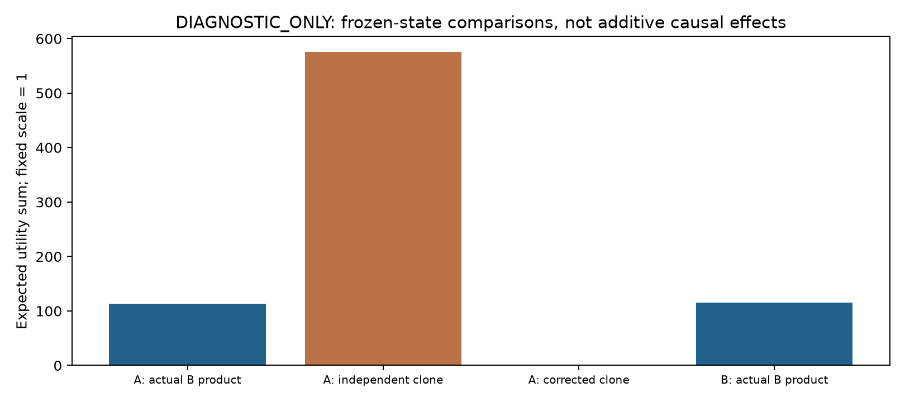
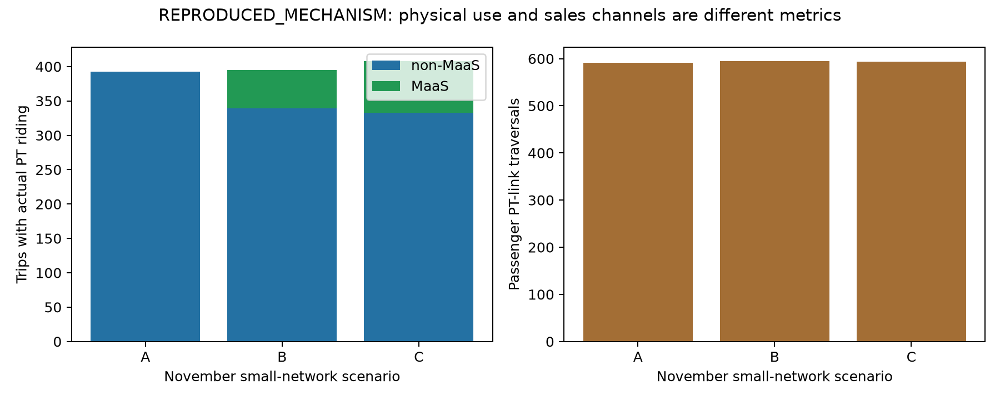
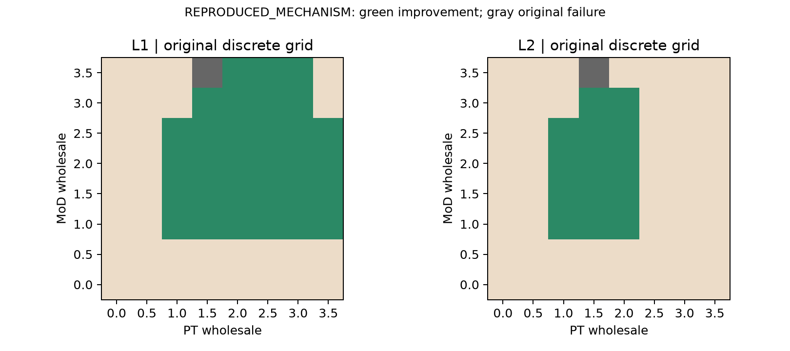
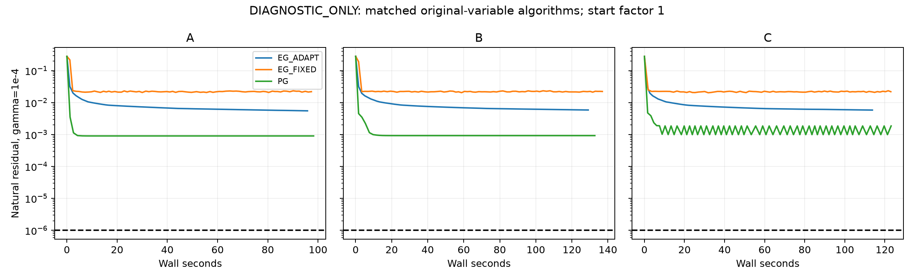

# MaaS Research v7.1 상세 검토 및 실험 보고서

2026년 11월 10일 | 저자의 설명을 먼저 확인한 조건부 재현·검증

**판정:** 기존 계산 결과를 복구하고 제한된 추가 검증을 완료했으며, 논문 전체의 정밀 재현 성공을 뜻하지 않습니다. 고정 상태에서 실제 B 상품 추가 효과는 113.564, 동일 독립 대안 복제는 575.180로 서로 다른 실험입니다. 유효 계약 63점 중 총량 공동 개선은 31점이고 모든 OD 평균 비악화는 14점입니다. 실제 투영 반복의 기준 통과는 0/27입니다. 아래 joint/nested 시범은 별도의 작은 warm-start 실험이며 실패한 EG 궤적을 수정한 결과가 아닙니다. 원문과 접근수요 집계·종료지표 차이가 남아 있으므로 이 실패를 저자의 알고리즘 실패로 귀속하지 않습니다. 시장모형 확장과 대규모 벤치마크는 게이트 이후 과제로 남겼습니다.

복구 상태: M03 JOINT_AUX만 완료·통과했고 NESTED_SAME_VI는 최종 상태나 사용 가능한 수치 체크포인트 없이 중단되었습니다. 최신 저연산 작업 지시에 따라 재시작하지 않았으며 성능 비교는 NOT_COMPARABLE입니다. 계산 시간은 이전 실행 기록이며 이번 복구에서 다시 계산한 값이 아닙니다. 최신 요청에서 GitHub 게시가 승인되었고 이전 no-push 문구는 과거 범위입니다.

## 1. 이번 업데이트의 핵심

이번 작업에서는 원문이 실제로 정의하고 설명한 내용을 먼저 인정한 뒤, 아직 검증되지 않은 현실성 가정을 분리했습니다. 저자는 전 도로망을 운행하는 단일 MoD를 정의했고, non-MaaS 내부에서도 PT와 MoD의 결합을 허용합니다. MaaS의 계획·환승 불편 감소에는 정성적 근거를 제시하며, Small의 공통 도매가격 실험과 Sioux의 상이한 도매단가도 구분됩니다. 여행자의 목표는 자기 기대효용 극대화이고 공동 Pareto 개선은 사후 비교입니다. OD별 VOT 민감도와 150개 초기값 교란 실험, 탄력·이질 수요와 복수 플랫폼 등의 후속과제도 실제로 존재합니다.

따라서 검토 질문은 ‘이런 내용을 언급하지 않았다’가 아니라 ‘그 설명만으로 현실 시장의 정도·분포·의사결정 시점까지 검증되었는가’입니다. R00은 요청된 18개 쟁점에 접근 수요 집계, 종료 잔차, VI와 글로벌 최적성의 관계를 더해 21개 근거 원장을 작성했습니다. 원문의 이론·모형 정의, 수치실험, 경험적 검증은 서로 다른 근거입니다. 스위스나 로잔 통합운임은 향후 외부 적용 시나리오이며 원 논문의 실증 대상이 아닙니다.

## 2. 원문과 독립 재구현 사이의 차이

원문 p.10의 MoD 접근시간은 전체 MoD 수요에 따른 동질적 접근시간입니다. 그러나 보존한 11월 기준선은 node/node 집계를 사용합니다. 이는 저자의 미정의 항목이라고 돌릴 수 없는 독립 재구성의 차이입니다. 이번 결과를 저자 설정의 정확한 복원으로 부르지 않습니다.

또한 p.10은 연속 반복값 차이를 잔차로 설명하고 p.19 Appendix A는 자연 투영 잔차를 명시합니다. EG에서는 두 값이 일반적으로 같지 않습니다. 이번에는 실제 반복 변화량과 고정 gamma=1e-4의 자연 잔차를 모두 기록합니다. 이 두 설명의 차이를 저자의 이론 오류로 단정하지 않고, 정량적 수렴 비교에서 해결해야 할 명세 문제로 남깁니다.

p.7은 비볼록 플랫폼 최적화와 그 VI 조건이 동치가 아님을 직접 설명합니다. 최적해가 VI를 만족한다는 것과 VI 잔차가 작은 모든 후보가 전역 이윤최대라는 것은 다릅니다. 이를 원문이 인식하지 못했다고 비판하는 대신 독립적인 가격 이탈 검사를 유지하는 것이 타당합니다.

## 3. G00-G02: 원본 보존과 PASS 검증

11월 76개 시도 전체를 재평가했으며 경제적 지표는 저장값과 1e-6 이내로 일치했습니다. 기존 PASS 75개는 원래 보조 좌표 기준을 통과했고 실패 1개는 그대로 남겼습니다. 직접 시간 역변환 잔차가 기준을 넘는 15개는 v7에서 이미 발견한 수치 표현 문제이며 이번에도 구분해 기록했습니다. 고정시간 가격 이탈 통계는 해시 검증된 원래 감사 결과를 참조하고, 경제·교통·회계 값은 새로 계산했습니다.

| Check (75 original PASS) | Median | 95th percentile | Max |
| --- | --- | --- | --- |
| natural_direct | 2.07e-07 | 1.4e-06 | 1.6e-06 |
| natural_aux | 1.55e-11 | 6.71e-10 | 2.33e-09 |
| scaled | 7.89e-10 | 2.84e-08 | 9.42e-08 |
| capacity_violation | 0 | 0 | 0 |
| complementarity | 0 | 0 | 0 |
| conservation | 1.14e-13 | 2.27e-13 | 3.41e-13 |
| accounting | 1.14e-13 | 2.27e-13 | 3.13e-13 |
| fixed_time_deviation | 5.68e-13 | 1.25e-12 | 1.48e-12 |
| fare_gain | 0 | 0 | 0 |

이 표의 분포는 실패를 섞은 최대값이 아니라 기존 PASS 집합의 중앙값·95분위수·최댓값입니다. BPR의 자유류 부근에서 시간을 유량으로 역변환하면 반올림 오차가 커질 수 있으므로 직접 잔차와 저장된 보조 유량좌표 잔차를 섞어 쓰지 않았습니다. 기준을 느슨하게 바꾸거나 기존 FAIL을 삭제하지 않았습니다.

## 4. E01-P: 실제 상품구조와 동일 대안 복제의 구분

A 또는 B의 시간·소매가격을 고정한 뒤 상위 선택집합을 비교했습니다. actual B product는 B의 MaaS OD 요금과 환승 페널티 10을 사용하는 실제 코드의 상품입니다. independent clone은 non-MaaS 체계적 효용을 정확히 복제한 가상 대안입니다. split corrected는 각 복제 대안의 효용에서 mu_mode*log(2)를 빼는 불변성 진단입니다. 루트 척도와 모드 척도는 현재 모두 1이며, 분석적 불변성 검사는 모드 척도 0.2/1/3과 극단 효용 조합을 포함한 12개 테스트를 통과했습니다.

| Frozen state | Choice set | Total expected utility |
| --- | --- | --- |
| A | no_maas | -16,826.681 |
| A | independent_clone | -16,251.500 |
| A | split_corrected | -16,826.681 |
| A | actual_B_product_B_fares | -16,713.117 |
| B | no_maas | -16,838.471 |
| B | independent_clone | -16,272.253 |
| B | split_corrected | -16,838.471 |
| B | actual_B_product_B_fares | -16,723.394 |

A 상태를 고정하면 실제 B 상품 추가의 기대효용 증가는 113.564, 독립 동일 복제는 575.180입니다. B 상태에서 실제 상품 추가 효과는 115.078입니다. 원래 재균형 A→B 차이는 여전히 103.287입니다. 고정 조건과 상품 정의가 다르므로 575.18을 103.29에서 차감하거나 ‘인공 편익 비중’을 계산하지 않습니다. A/B 기준 참조만 균형이고 교차 조합은 균형이 아닙니다. 수행하지 않은 placebo 재균형 파일도 만들지 않았습니다.

이 진단은 구현된 상위 Shannon 선택의 중복 민감도에 관한 것입니다. 일반 PUMCM 전체가 IIA를 강제한다는 주장을 하지 않습니다. Nested/cross-nested 구조는 자료가 없는 현 단계에서 설계 가설이며, 그 자체가 현실적 정답이나 교정된 수요모형은 아닙니다.

## 5. E02-PT: 접근·물리 이용·판매채널

첫 PT 접근과 실제 PT 차량 링크 통과, PT 유료 링크, 승차·환승 사건, 실제 PT 이용 통행과 MoD/PT 결합 통행을 나누었습니다. 결합 통행은 접근량을 합쳐서 구한 것이 아니라 흡수 Markov 과정의 사건 확률을 계산해 식별합니다. 확률과 회계 항등식 검증을 함께 수행합니다.

| Case/channel | First PT | PT ride-links | PT-using trips | MoD+PT trips |
| --- | --- | --- | --- | --- |
| A_no_maas / non | 392.466 | 591.608 | 392.464 | 0.021 |
| B_maas_no_transfer_advantage / non | 339.576 | 524.078 | 339.575 | 0.020 |
| B_maas_no_transfer_advantage / maas | 55.089 | 70.805 | 55.089 | 0.003 |
| C_maas_paper_advantage / non | 332.906 | 503.258 | 332.904 | 0.015 |
| C_maas_paper_advantage / maas | 77.328 | 90.377 | 75.128 | 17.013 |
| sioux_node_node_total0_without / non | 62,577.544 | 112,308.905 | 65,214.687 | 5,200.178 |
| sioux_node_node_total0_with / non | 32,093.932 | 49,177.765 | 32,134.531 | 79.065 |
| sioux_node_node_total0_with / maas | 40,244.731 | 133,941.801 | 61,051.522 | 26,761.642 |

| Case total | First PT | PT-using trips | PT ride-links | MoD+PT trips |
| --- | --- | --- | --- | --- |
| A_no_maas | 392.466 | 392.464 | 591.608 | 0.021 |
| B_maas_no_transfer_advantage | 394.666 | 394.664 | 594.882 | 0.023 |
| C_maas_paper_advantage | 410.233 | 408.032 | 593.635 | 17.028 |

실제 PT 이용 통행 수와 차량 링크 통과량은 같은 방향으로 움직이지 않을 수 있습니다. 이 재구현의 PT 수준은 원문 시장분담 수준과도 정확히 일치하지 않습니다. 지표 분리는 해석을 정교하게 만드는 것이며 수치 차이 자체를 해소한 것은 아닙니다.

Small의 A/B/C, 원래 유효 E03 격자, 별도 표시된 V5 Sioux before/after를 진단했습니다. 10월 최종 v6를 11월 원시 자료로 대체하지 않았습니다. 실제 거리단위가 외부적으로 검증되지 않았으므로 passenger-km 대신 모형 길이 단위의 누적 거리를 제공합니다.

원문 Table 2의 PT 분담 합계 25.5% 유지와 §5.1.3의 OD(1,5) 국소 PT 증가 설명은 양립할 수 있습니다. 전체 합계가 같다고 모든 PT 차량 링크 유량이 동일했다고 주장해서는 안 됩니다. Table 3의 10.6%→28.6% 역시 다른 네트워크·수요 아래의 결과입니다. 원문의 시장분담 지표가 본 코드의 첫 접근 지표와 정확히 같은지는 확정하지 않았습니다.

## 6. E03-D/V: 계약·수익·분배와 비용 형태

원래 63개 유효 격자에서 L1 총량 공동 개선은 31점, 모든 OD 평균이 비악화인 L2는 14점입니다. L3 개인별 Pareto 개선은 NOT_IDENTIFIED입니다. 총량 기준은 +0.001 초과, OD 비악화는 1e-8 오차를 적용합니다. 소매수입 변화와 도매수입을 합해 운영자 총수익 변화가 되는지 검증하고, MaaS OD 요금매출과 도매지급, OD 손실과 해당 수요 비중을 별도 CSV로 제공합니다.

기존 PT 참여조건 전환 구간에 MoD 1.4/1.5/1.6 × PT 0.7/0.8/0.9의 9개 점을 사전 등록해 추가 계산했습니다. 원하는 부호가 나올 때까지 탐색하지 않았고 격자 사이를 균형으로 보간하지 않았습니다.

| MoD wholesale | PT wholesale | Status | PT revenue gain | L1 | L2 |
| --- | --- | --- | --- | --- | --- |
| 1.4 | 0.7 | PASS | -17.342 | False | False |
| 1.4 | 0.8 | PASS | -2.645 | False | False |
| 1.4 | 0.9 | PASS | 10.546 | True | True |
| 1.5 | 0.7 | PASS | -18.255 | False | False |
| 1.5 | 0.8 | PASS | -4.463 | False | False |
| 1.5 | 0.9 | PASS | 7.924 | True | True |
| 1.6 | 0.7 | PASS | -18.990 | False | False |
| 1.6 | 0.8 | PASS | -6.034 | False | False |
| 1.6 | 0.9 | PASS | 5.612 | True | True |

기존 실패 (3.5,1.5)는 원래 격자에서 제외한 채 보존합니다. 이웃점 시작으로 통과했던 v7의 별도 해도 새로 재평가해 진단으로 연결했으며 원래 63/64 판정을 바꾸지 않았습니다.

| Cost structure | Parameter | L1 points | L2 points |
| --- | --- | --- | --- |
| fixed | 0.0 | 31 | 14 |
| fixed | 25.0 | 27 | 14 |
| fixed | 50.0 | 16 | 12 |
| fixed | 100.0 | 6 | 6 |
| per_trip | 0.1 | 31 | 14 |
| per_trip | 0.25 | 31 | 14 |
| per_trip | 0.5 | 31 | 14 |
| per_trip | 1.0 | 31 | 14 |
| revenue_fraction | 0.05 | 31 | 14 |
| revenue_fraction | 0.1 | 31 | 14 |
| revenue_fraction | 0.25 | 25 | 14 |
| revenue_fraction | 0.5 | 0 | 0 |

플랫폼 추가비용은 고정비용, MaaS 통행당 비용, 매출비례 비용으로 나누었습니다. 실제 운영비 추정이나 시장 이탈을 포함한 재균형 결과가 아니라 사후 참여조건 진단입니다. 예를 들어 비용 형태가 달라지면 동일한 양의 잔여수익이라도 통과 여부가 달라집니다. 이는 상업적 지속가능성이 입증됐다는 뜻이 아닙니다. 2차원 개선영역도 내생 협상가격의 해가 아니며 저자가 이미 논의한 참여조건·협상 문제의 확장입니다.

## 7. M01: 동일 조건 실제 반복 비교

A/B/C 각각에 초기값 배율 0.95/1/1.05를 적용하고 PG·고정 EG·적응형 EG를 실행했습니다. 모든 방법은 같은 H와 제약, 초기 step 1e-4, 자연 잔차 gamma=1e-4, 기준 1e-6, solver H 예산 20,000회를 사용합니다. 적응형의 거절 평가도 포함하고 최종 검증 H는 solver 예산과 구분해 전체 호출수에 포함합니다. 원문의 EG를 보조 root 해로 대체하지 않습니다.

| Case | Method | Start | Status | Natural residual | H solver/total | Seconds |
| --- | --- | --- | --- | --- | --- | --- |
| A_no_maas | EG_ADAPT | 0.95 | FAILED_NUMERICAL_CHECK | 0.0031 | 20000/20001 | 97.616 |
| A_no_maas | EG_ADAPT | 1.0 | FAILED_NUMERICAL_CHECK | 0.0055 | 20000/20001 | 97.177 |
| A_no_maas | EG_ADAPT | 1.05 | FAILED_NUMERICAL_CHECK | 0.00568 | 20000/20001 | 100.080 |
| A_no_maas | EG_FIXED | 0.95 | FAILED_NUMERICAL_CHECK | 0.000905 | 20000/20001 | 101.314 |
| A_no_maas | EG_FIXED | 1.0 | FAILED_NUMERICAL_CHECK | 0.0216 | 20000/20001 | 98.567 |
| A_no_maas | EG_FIXED | 1.05 | FAILED_NUMERICAL_CHECK | 0.0221 | 20000/20001 | 95.870 |
| A_no_maas | PG | 0.95 | FAILED_NUMERICAL_CHECK | 0.000905 | 20000/20001 | 103.646 |
| A_no_maas | PG | 1.0 | FAILED_NUMERICAL_CHECK | 0.000904 | 20000/20001 | 99.686 |
| A_no_maas | PG | 1.05 | FAILED_NUMERICAL_CHECK | 0.000904 | 20000/20001 | 97.901 |
| B_maas_no_transfer_advantage | EG_ADAPT | 0.95 | FAILED_NUMERICAL_CHECK | 0.00391 | 20000/20001 | 138.067 |
| B_maas_no_transfer_advantage | EG_ADAPT | 1.0 | FAILED_NUMERICAL_CHECK | 0.00585 | 20000/20001 | 130.755 |
| B_maas_no_transfer_advantage | EG_ADAPT | 1.05 | FAILED_NUMERICAL_CHECK | 0.00592 | 20000/20001 | 159.134 |
| B_maas_no_transfer_advantage | EG_FIXED | 0.95 | FAILED_NUMERICAL_CHECK | 0.000926 | 20000/20001 | 136.242 |
| B_maas_no_transfer_advantage | EG_FIXED | 1.0 | FAILED_NUMERICAL_CHECK | 0.0223 | 20000/20001 | 138.668 |
| B_maas_no_transfer_advantage | EG_FIXED | 1.05 | FAILED_NUMERICAL_CHECK | 0.0217 | 20000/20001 | 129.604 |
| B_maas_no_transfer_advantage | PG | 0.95 | FAILED_NUMERICAL_CHECK | 0.000926 | 20000/20001 | 135.974 |
| B_maas_no_transfer_advantage | PG | 1.0 | FAILED_NUMERICAL_CHECK | 0.000926 | 20000/20001 | 134.744 |
| B_maas_no_transfer_advantage | PG | 1.05 | FAILED_NUMERICAL_CHECK | 0.000926 | 20000/20001 | 131.628 |
| C_maas_paper_advantage | EG_ADAPT | 0.95 | FAILED_NUMERICAL_CHECK | 0.00403 | 20000/20001 | 158.763 |
| C_maas_paper_advantage | EG_ADAPT | 1.0 | FAILED_NUMERICAL_CHECK | 0.00582 | 20000/20001 | 115.355 |
| C_maas_paper_advantage | EG_ADAPT | 1.05 | FAILED_NUMERICAL_CHECK | 0.00575 | 20000/20001 | 131.145 |
| C_maas_paper_advantage | EG_FIXED | 0.95 | FAILED_NUMERICAL_CHECK | 0.00194 | 20000/20001 | 162.222 |
| C_maas_paper_advantage | EG_FIXED | 1.0 | FAILED_NUMERICAL_CHECK | 0.0233 | 20000/20001 | 124.551 |
| C_maas_paper_advantage | EG_FIXED | 1.05 | FAILED_NUMERICAL_CHECK | 0.0218 | 20000/20001 | 134.963 |
| C_maas_paper_advantage | PG | 0.95 | FAILED_NUMERICAL_CHECK | 0.000981 | 20000/20001 | 174.534 |
| C_maas_paper_advantage | PG | 1.0 | FAILED_NUMERICAL_CHECK | 0.000994 | 20000/20001 | 125.014 |
| C_maas_paper_advantage | PG | 1.05 | FAILED_NUMERICAL_CHECK | 0.00186 | 20000/20001 | 128.363 |

실제 통과는 27개 중 0개입니다. 실패한 최종 가격·수익은 균형표에서 제외하고 원시 진단값으로만 보존합니다. 모든 시도를 수행했다고 해서 수렴까지의 성공적인 성능 비교가 달성된 것은 아닙니다. 유효한 서로 다른 해가 확인되지 않았으므로 복수 균형이라고 해석하지 않습니다. 독립 재구현 설정이 저자 설정과 다르므로 원문 EG의 실패나 이론 반증이라고도 말하지 않습니다.

연속 반복 변화가 먼저 1e-6 아래로 내려간 기록은 3개이며 해당 순간의 자연 잔차도 별도 파일에 기록합니다. 작은 step이나 정체로 반복 변화가 작아지는 것과 원래 VI 정확도를 달성하는 것은 구분해야 합니다.

각 조합은 새 프로세스에서 순차 실행했고 BLAS/OMP/MKL 스레드를 1로 지정했습니다. 따라서 v7처럼 이전 알고리즘의 할당 이력을 같은 프로세스 메모리로 측정하는 문제를 줄였습니다. RSS는 관측된 프로세스 메모리 최댓값이며 순간 피크 보장이 아닙니다. 시간은 계측 및 일반적인 로컬 환경 활동을 포함합니다. Small 통과 게이트를 충족하지 못한 경우 Sioux 및 추가 계약 사례 확대는 NOT_RUN입니다.

## 8. M02: 전략적 시점의 구분

(1.5,1.5)와 (3,3)에서 두 운영자별 -5%/0%/+5% 가격 변경 12개를 새로 계산했습니다. 경쟁 소매가격과 MaaS 요금은 고정하고 고정 시간 반응과 교통 재균형 반응을 비교했습니다.

| Contract | Operator | Price factor | Fixed-time gain | Traffic-response gain |
| --- | --- | --- | --- | --- |
| mod_1.5_pt_1.5 | mod | 0.95 | -1.268 | -25.870 |
| mod_1.5_pt_1.5 | mod | 1.05 | -1.193 | 25.191 |
| mod_1.5_pt_1.5 | pt | 0.95 | -0.773 | -20.284 |
| mod_1.5_pt_1.5 | pt | 1.05 | -0.697 | 19.784 |
| mod_3_pt_3 | mod | 0.95 | -1.272 | -25.564 |
| mod_3_pt_3 | mod | 1.05 | -1.210 | 25.127 |
| mod_3_pt_3 | pt | 0.95 | -0.853 | -21.148 |
| mod_3_pt_3 | pt | 1.05 | -0.774 | 20.771 |

이는 같은 Nash 이탈 지표가 아닙니다. 후자는 다른 반응 시점의 반사실이며 유한 가격 탐색입니다. 전역 최적반응 증명도 아니고 원래 단일 수준 게임의 Nash 위반이라고 자동 판단하지 않습니다.

## 9. M03: 같은 VI를 푸는 nested 시범

JOINT_AUX는 교통 유량좌표·플랫폼 요금·소매가격을 함께 풀고, NESTED_SAME_VI는 외부 가격 잔차 평가마다 내부 교통균형을 풉니다. 두 방법 모두 (1.5,1.5) 참조해의 모든 가격을 3% 높인 같은 시작점에서 출발하고 원래 고정 시간 가격 편미분 조건을 유지합니다. 원문의 EG와 이 두 보조 해법의 비교를 가상 운영자 자체의 비교로 대체하지 않습니다.

| Method | Status | H calls | PUMCM | Inner solves | Full scaled | Wall (s) |
| --- | --- | --- | --- | --- | --- | --- |
| JOINT_AUX | PASS | 1490 | 8946 | 0 | 1.76e-11 | 7.511 |
| NESTED_SAME_VI | INTERRUPTED_NOT_COMPLETED | UNKNOWN | UNKNOWN | UNKNOWN | not available | not available |

외부 수치 solver가 잔차의 합성함수를 미분하는 것과, 사업자가 교통반응까지 포함한 이윤 전미분을 목적함수에 사용하는 것은 다릅니다. 이번 시범은 전자입니다. 후자는 다른 게임이 될 수 있어 별도 정당화 없이 비교할 수 없습니다. 두 최종 검증이 모두 통과해야 이 작은 warm-start 예에서의 비용 비교가 가능하며 하나라도 실패하면 성능 비교는 NOT_COMPARABLE입니다. 성공해도 대규모 일반적 속도 우위를 입증하지 않습니다.

## 10. 후속 시장 시나리오와 재개

낮은 MoD 초기 비중은 명시적 가상 사전 시장 조건으로, PT 통합운임은 요금 지불 상태를 갖춘 별도 모형으로 접근합니다. 이질성은 집단별 확률·민감도·흐름과 공유 용량·혼잡을 함께 바꾸어야 하고 효용은 공통 화폐 척도를 명시해야 합니다. 가입 가능성과 실제 구독은 다르며 공공 PT·정부 예산은 별도 목적함수와 회계가 필요합니다. 협상·PAYG/구독·혼합결제 설계도 이런 종속관계를 따라야 합니다. 상세 설계와 NOT_RUN 범위는 market_scenarios.md에 남겼습니다.

원본과 태그는 보존했고 새 로컬 브랜치 research-v7-1-critical-validation 및 results/research_v7_1에서 작업했습니다. 원격 Push·저자 연락은 하지 않았습니다. 재실행·해시·중단 지침은 README_RESEARCH_V7_1.md, 주장별 발표 가능 문구는 claim_evidence_ledger.csv에 있습니다.

Source: supplied Yao, Ma & Zhang (2026), TRC 188, 105703, DOI 10.1016/j.trc.2026.105703; pp.2-19, especially Sections 2-6 and Appendix A. Page-specific paraphrases and source hash: paper_defense_ledger.csv. November source tag research-handoff-20261108; independent code rooted in maas-reproduction-v5. v7.1 request is a work specification, not original-paper evidence.

## 추가 수치 진단: 자유류 경계에서의 EG 정체

유량이 0인 독립 역 BPR 성분에서 자유류 시간 5, 용량 300, 현재 시간 5.001, step 1e-4를 적용하면 EG의 반복 변화량은 정확히 0인데 자연 잔차는 0.001로 남습니다. 예측점이 자유류 하한에 도달해 H=0이 되면 교정점이 이전 값으로 돌아오기 때문이며, 5회 반복으로 확인했습니다. 이는 종료지표 차이에 대한 반례이지 네트워크 균형이나 EG 정리의 반증이 아닙니다. 역 BPR 미분은 자유류 부근에서 유계가 아닙니다. 실제 코드에서 목적지별 그래프에 전혀 등장하지 않는 혼잡 자원과 각 실험의 최종 잔차 상위 5개 성분도 별도 파일로 제공합니다. 이 원인 하나로 모든 실패를 설명하지 않으며 가격 결합과 적응형 step 축소는 별도 요인입니다. 원래 벤치마크 반복값을 수정하거나 숨기지 않았습니다. 자세한 식과 원시 값은 m01_boundary_diagnosis.md, m01_boundary_microtest.csv, m01_final_residual_components.csv에 있습니다.
