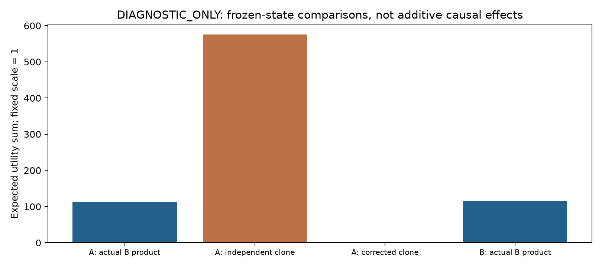
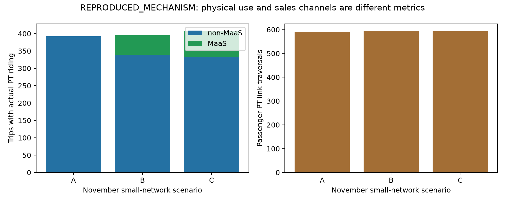
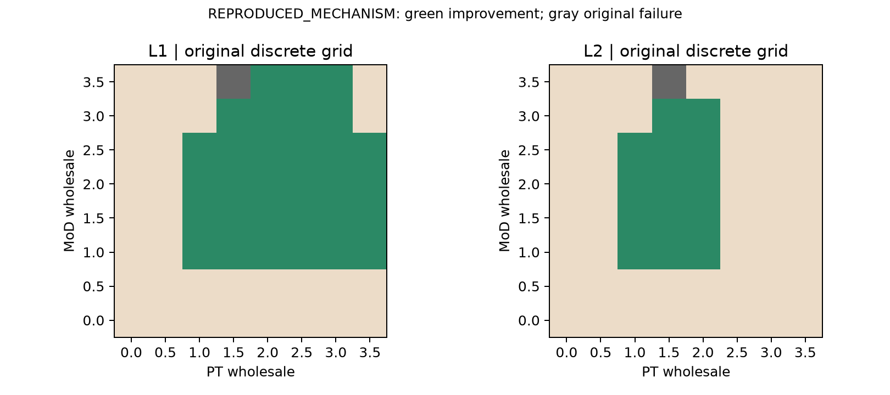
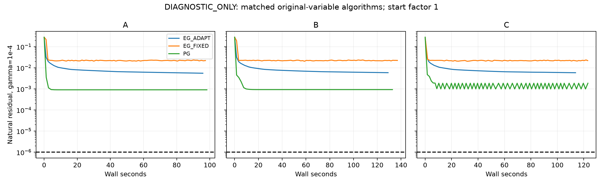

# MaaS Research v7.1: technical review and experimental validation

2026-11-10 | Positive contribution, precise validation questions, bounded evidence

## Findings at a glance

This is a recovered, partially completed validation study, not an exact reproduction of all paper results. The frozen actual-product increment is 113.564, whereas identical independent duplication gives 575.180; they are different experiments. Of 63 accepted contract points, 31 improve aggregate interests and only 14 avoid mean-utility losses in every OD. Actual projection convergence acceptance is 0/27. Joint/nested results below are a separate small warm-start prototype, not a repair of failed EG trajectories. Remaining differences in access-demand aggregation and stopping conventions prevent attribution of our numerical failures to the authors. Market extensions and large-network benchmark expansion remain gated.

Recovery status: M03 JOINT_AUX finished and passed; NESTED_SAME_VI was interrupted without final state or a usable numerical checkpoint. It was not resumed under the latest low-compute instruction. The comparison is NOT_COMPARABLE. Historical solver timings are from the earlier run, not newly executed here. GitHub publication is authorized by the latest request; earlier no-push notes describe the previous scope.

## Contribution and source audit

The paper supplies a motivated dual traffic/virtual-operator formulation, differentiable PUMCM follower responses, VI conditions and existence analysis, numerical EG results and several sensitivity experiments. Our review begins by acknowledging these contributions. R00 checks 21 issues, including the 18 requested topics and three additional qualifications. Non-MaaS explicitly permits multimodal travel. A single road-wide MoD operator is defined. Transfer convenience has a qualitative rationale. Small wholesale sensitivity is symmetric but Sioux wholesale prices differ. Travelers maximize their own utilities; aggregate Pareto language is a comparison, not their collective objective. Section 6 recognizes negotiation, demand and platform extensions, while Section 5.1.5 already varies OD VOT.

Two source-to-code issues must not be hidden. Page 10 explicitly aggregates MoD access across the network, whereas our preserved November baseline uses node/node resources; these are conditional reconstruction outcomes. Also page 10 describes consecutive-iterate differences, while Appendix A specifies a projected natural residual. Both are recorded in M01. Page 7 explicitly distinguishes nonconvex optimization from its necessary VI condition; passing residuals is not a proof of global Nash optimality. Neither the paper nor this study is a Lausanne empirical calibration.

## G00-G02: integrity and numerical contract

All 76 November attempts were reevaluated, including the original failure. Economic metrics match within 1e-6. The 75 original PASS states pass their auxiliary-coordinate criteria; 15 exceed 1e-6 if rounded times are directly inverted. No threshold was relaxed or old failure relabeled. The inverse BPR map is ill-conditioned near free flow; direct and retained-coordinate residuals are therefore both exported. Fixed-time deviation statistics below reference the hash-verified original audits; economic, traffic and accounting values were freshly recomputed.

| Check (75 original PASS) | Median | 95th percentile | Max |
| --- | --- | --- | --- |
| natural_direct | 2.07e-07 | 1.4e-06 | 1.6e-06 |
| natural_aux | 1.55e-11 | 6.71e-10 | 2.33e-09 |
| scaled | 7.89e-10 | 2.84e-08 | 9.42e-08 |
| capacity_violation | 0 | 0 | 0 |
| complementarity | 0 | 0 | 0 |
| conservation | 1.14e-13 | 2.27e-13 | 3.41e-13 |
| accounting | 1.14e-13 | 2.27e-13 | 3.13e-13 |
| fixed_time_deviation | 5.68e-13 | 1.25e-12 | 1.48e-12 |
| fare_gain | 0 | 0 | 0 |

## E01-P: static product versus duplication tests

Static tests freeze A or B times and retail prices. The actual-B-product cross uses B's OD MaaS fares and transfer penalty 10; the clone exactly copies the systematic non-MaaS value. Independent duplication gives mu*log(1+p_non); two copies each shifted by -mu*log(2) preserve inclusive value and combined probability. Twelve analytic unit tests cover three mode scales and extreme utility differences. These are diagnostics of the implemented upper Shannon layer, not all PUMCM perturbations.

| Frozen state | Choice set | Total expected utility |
| --- | --- | --- |
| A | no_maas | -16,826.681 |
| A | independent_clone | -16,251.500 |
| A | split_corrected | -16,826.681 |
| A | actual_B_product_B_fares | -16,713.117 |
| B | no_maas | -16,838.471 |
| B | independent_clone | -16,272.253 |
| B | split_corrected | -16,838.471 |
| B | actual_B_product_B_fares | -16,723.394 |

The A-frozen actual-product increment is 113.564, versus 575.180 for the independent identical clone; the B-frozen actual-product increment is 115.078. The original equilibrium B-A remains 103.287. Different conditioning paths do not identify causal shares, and no clone increment is subtracted from the equilibrium gain. A and B references reproduce their equilibria; crossed states are not equilibria. No new placebo re-equilibrium file is fabricated. Nested/correlated alternatives remain design hypotheses without calibration data.

## E02-PT: physical use and sales channels

The PT dictionary distinguishes first access, actual ride links, paid links, boarding events, distance proxies and probability of actual PT/MoD joint use. Event probabilities are obtained from absorbing Markov kernels, not inferred from access totals. Small A/B/C and 63 accepted November coarse cases are recomputed; V5 node/node Sioux states are separately identified. October v6 is not substituted.

| Case/channel | First PT | PT ride-links | PT-using trips | MoD+PT trips |
| --- | --- | --- | --- | --- |
| A_no_maas / non | 392.466 | 591.608 | 392.464 | 0.021 |
| B_maas_no_transfer_advantage / non | 339.576 | 524.078 | 339.575 | 0.020 |
| B_maas_no_transfer_advantage / maas | 55.089 | 70.805 | 55.089 | 0.003 |
| C_maas_paper_advantage / non | 332.906 | 503.258 | 332.904 | 0.015 |
| C_maas_paper_advantage / maas | 77.328 | 90.377 | 75.128 | 17.013 |
| sioux_node_node_total0_without / non | 62,577.544 | 112,308.905 | 65,214.687 | 5,200.178 |
| sioux_node_node_total0_with / non | 32,093.932 | 49,177.765 | 32,134.531 | 79.065 |
| sioux_node_node_total0_with / maas | 40,244.731 | 133,941.801 | 61,051.522 | 26,761.642 |

| Case total | First PT | PT-using trips | PT ride-links | MoD+PT trips |
| --- | --- | --- | --- | --- |
| A_no_maas | 392.466 | 392.464 | 591.608 | 0.021 |
| B_maas_no_transfer_advantage | 394.666 | 394.664 | 594.882 | 0.023 |
| C_maas_paper_advantage | 410.233 | 408.032 | 593.635 | 17.028 |

PT-using trips and ride-link traversals need not move in the same direction. These reconstructed totals also do not reproduce the paper's PT market-share level exactly; separating indicators diagnoses interpretation, rather than erasing that quantitative discrepancy.

Table 2's unchanged aggregate PT share is compatible with the paper's stated OD(1,5) increase; it does not imply identical PT flows everywhere. Table 3 has a different network/demand setting. Reconstructed distance is reported in model units, not validated passenger-km. The paper's exact market-share reporting convention is not assumed identical to this code's first-access shares.

## E03-D/V: distribution, local boundary and hypothetical costs

The original 63 accepted coarse cases retain 31 L1 aggregate improving and 14 L2 all-OD-mean nonworse cases. L3 individual Pareto remains NOT_IDENTIFIED. Strict aggregate tolerance is 0.001; OD nonworse tolerance is 1e-8. Revenue decomposition reconciles retail changes plus wholesale receipts with operator gains. OD fares, sales, wholesale payments, losses and demand shares are exported. The original (3.5,1.5) failure remains excluded; v7's separately accepted neighbor-start diagnosis is freshly reevaluated and labeled diagnostic.

Nine predeclared local points, MoD={1.4,1.5,1.6} and PT={0.7,0.8,0.9}, test the coarse PT participation transition without interpolation or sign-target fitting:

| MoD wholesale | PT wholesale | Status | PT revenue gain | L1 | L2 |
| --- | --- | --- | --- | --- | --- |
| 1.4 | 0.7 | PASS | -17.342 | False | False |
| 1.4 | 0.8 | PASS | -2.645 | False | False |
| 1.4 | 0.9 | PASS | 10.546 | True | True |
| 1.5 | 0.7 | PASS | -18.255 | False | False |
| 1.5 | 0.8 | PASS | -4.463 | False | False |
| 1.5 | 0.9 | PASS | 7.924 | True | True |
| 1.6 | 0.7 | PASS | -18.990 | False | False |
| 1.6 | 0.8 | PASS | -6.034 | False | False |
| 1.6 | 0.9 | PASS | 5.612 | True | True |

Additional platform costs are deliberately hypothetical and applied after equilibrium. They represent fixed, per-MaaS-trip or revenue-proportional costs; they are not estimated operating costs or endogenous exit decisions.

| Cost structure | Parameter | L1 points | L2 points |
| --- | --- | --- | --- |
| fixed | 0.0 | 31 | 14 |
| fixed | 25.0 | 27 | 14 |
| fixed | 50.0 | 16 | 12 |
| fixed | 100.0 | 6 | 6 |
| per_trip | 0.1 | 31 | 14 |
| per_trip | 0.25 | 31 | 14 |
| per_trip | 0.5 | 31 | 14 |
| per_trip | 1.0 | 31 | 14 |
| revenue_fraction | 0.05 | 31 | 14 |
| revenue_fraction | 0.1 | 31 | 14 |
| revenue_fraction | 0.25 | 25 | 14 |
| revenue_fraction | 0.5 | 0 | 0 |

The feasible participation set changes with cost structure. The two-dimensional grid is not a solved wholesale negotiation game. Revenue-dependent costs and fixed costs should not be conflated.

## M01: completed attempts, convergence outcome

Each method uses the same original H/project, initial step 1e-4, natural gamma 1e-4, 1e-6 target and 20,000 solver-H budget. A/B/C each have initial factors 0.95, 1, 1.05. Adaptive halving uses eta=0.7 and counts rejected evaluations. Every run is a separate sequential process, with BLAS/OMP/MKL threads set to one; validation calls are separate from the solver budget but included in total H/graph counts. The whole operator-event CSV is retained, not just iteration counts. Memory is sampled process RSS, not a guaranteed instantaneous peak. CPU/wall include instrumentation and normal local-machine activity.

| Case | Method | Start | Status | Natural residual | H solver/total | Seconds |
| --- | --- | --- | --- | --- | --- | --- |
| A_no_maas | EG_ADAPT | 0.95 | FAILED_NUMERICAL_CHECK | 0.0031 | 20000/20001 | 97.616 |
| A_no_maas | EG_ADAPT | 1.0 | FAILED_NUMERICAL_CHECK | 0.0055 | 20000/20001 | 97.177 |
| A_no_maas | EG_ADAPT | 1.05 | FAILED_NUMERICAL_CHECK | 0.00568 | 20000/20001 | 100.080 |
| A_no_maas | EG_FIXED | 0.95 | FAILED_NUMERICAL_CHECK | 0.000905 | 20000/20001 | 101.314 |
| A_no_maas | EG_FIXED | 1.0 | FAILED_NUMERICAL_CHECK | 0.0216 | 20000/20001 | 98.567 |
| A_no_maas | EG_FIXED | 1.05 | FAILED_NUMERICAL_CHECK | 0.0221 | 20000/20001 | 95.870 |
| A_no_maas | PG | 0.95 | FAILED_NUMERICAL_CHECK | 0.000905 | 20000/20001 | 103.646 |
| A_no_maas | PG | 1.0 | FAILED_NUMERICAL_CHECK | 0.000904 | 20000/20001 | 99.686 |
| A_no_maas | PG | 1.05 | FAILED_NUMERICAL_CHECK | 0.000904 | 20000/20001 | 97.901 |
| B_maas_no_transfer_advantage | EG_ADAPT | 0.95 | FAILED_NUMERICAL_CHECK | 0.00391 | 20000/20001 | 138.067 |
| B_maas_no_transfer_advantage | EG_ADAPT | 1.0 | FAILED_NUMERICAL_CHECK | 0.00585 | 20000/20001 | 130.755 |
| B_maas_no_transfer_advantage | EG_ADAPT | 1.05 | FAILED_NUMERICAL_CHECK | 0.00592 | 20000/20001 | 159.134 |
| B_maas_no_transfer_advantage | EG_FIXED | 0.95 | FAILED_NUMERICAL_CHECK | 0.000926 | 20000/20001 | 136.242 |
| B_maas_no_transfer_advantage | EG_FIXED | 1.0 | FAILED_NUMERICAL_CHECK | 0.0223 | 20000/20001 | 138.668 |
| B_maas_no_transfer_advantage | EG_FIXED | 1.05 | FAILED_NUMERICAL_CHECK | 0.0217 | 20000/20001 | 129.604 |
| B_maas_no_transfer_advantage | PG | 0.95 | FAILED_NUMERICAL_CHECK | 0.000926 | 20000/20001 | 135.974 |
| B_maas_no_transfer_advantage | PG | 1.0 | FAILED_NUMERICAL_CHECK | 0.000926 | 20000/20001 | 134.744 |
| B_maas_no_transfer_advantage | PG | 1.05 | FAILED_NUMERICAL_CHECK | 0.000926 | 20000/20001 | 131.628 |
| C_maas_paper_advantage | EG_ADAPT | 0.95 | FAILED_NUMERICAL_CHECK | 0.00403 | 20000/20001 | 158.763 |
| C_maas_paper_advantage | EG_ADAPT | 1.0 | FAILED_NUMERICAL_CHECK | 0.00582 | 20000/20001 | 115.355 |
| C_maas_paper_advantage | EG_ADAPT | 1.05 | FAILED_NUMERICAL_CHECK | 0.00575 | 20000/20001 | 131.145 |
| C_maas_paper_advantage | EG_FIXED | 0.95 | FAILED_NUMERICAL_CHECK | 0.00194 | 20000/20001 | 162.222 |
| C_maas_paper_advantage | EG_FIXED | 1.0 | FAILED_NUMERICAL_CHECK | 0.0233 | 20000/20001 | 124.551 |
| C_maas_paper_advantage | EG_FIXED | 1.05 | FAILED_NUMERICAL_CHECK | 0.0218 | 20000/20001 | 134.963 |
| C_maas_paper_advantage | PG | 0.95 | FAILED_NUMERICAL_CHECK | 0.000981 | 20000/20001 | 174.534 |
| C_maas_paper_advantage | PG | 1.0 | FAILED_NUMERICAL_CHECK | 0.000994 | 20000/20001 | 125.014 |
| C_maas_paper_advantage | PG | 1.05 | FAILED_NUMERICAL_CHECK | 0.00186 | 20000/20001 | 128.363 |

Observed acceptance: 0/27. Failed iterate prices and revenues are diagnostic only. All performed attempts are recorded; the requested successful time-to-convergence comparison is not achieved if methods remain failed. No equivalence with the author's numerical settings, universal ranking, nonexistence or multiple-equilibrium claim follows. 3 runs have an observed iterate-change threshold crossing; m01_iterate_vs_natural.csv records their natural residual at that crossing, exposing why the two stopping descriptions need to be distinguished. Sioux and additional contract cases are NOT_RUN where the small-network convergence gate is not met.

## M02 and M03: strategic versus numerical nesting

Twelve new finite -5%, 0%, +5% retail-price probes at (1.5,1.5) and (3,3) keep rival retail and MaaS fares fixed. Re-equilibrated traffic is a different response-timing counterfactual; the original fixed-time deviation is not replaced.

| Contract | Operator | Price factor | Fixed-time gain | Traffic-response gain |
| --- | --- | --- | --- | --- |
| mod_1.5_pt_1.5 | mod | 0.95 | -1.268 | -25.870 |
| mod_1.5_pt_1.5 | mod | 1.05 | -1.193 | 25.191 |
| mod_1.5_pt_1.5 | pt | 0.95 | -0.773 | -20.284 |
| mod_1.5_pt_1.5 | pt | 1.05 | -0.697 | 19.784 |
| mod_3_pt_3 | mod | 0.95 | -1.272 | -25.564 |
| mod_3_pt_3 | mod | 1.05 | -1.210 | 25.127 |
| mod_3_pt_3 | pt | 0.95 | -0.853 | -21.148 |
| mod_3_pt_3 | pt | 1.05 | -0.774 | 20.771 |

The same-VI nested prototype retains original partial price derivatives while solving traffic internally. The joint auxiliary comparator uses explicit fares too; no exact-fare shortcut substitutes for a competing algorithm. These are numerical solution strategies for the same stationary conditions, not a full comparison against leaders optimizing total profit derivatives through traffic equilibrium.

| Method | Status | H calls | PUMCM | Inner solves | Full scaled | Wall (s) |
| --- | --- | --- | --- | --- | --- | --- |
| JOINT_AUX | PASS | 1490 | 8946 | 0 | 1.76e-11 | 7.511 |
| NESTED_SAME_VI | INTERRUPTED_NOT_COMPLETED | UNKNOWN | UNKNOWN | UNKNOWN | not available | not available |

Only if both final validations pass are their timings comparable within this warm-start toy example. If either fails, the performance comparison is NOT_COMPARABLE. Even success is not evidence of general large-network speedup. Full settings and caveats are in m03_comparability.md.

## Deferred market extensions and reproducibility

E10 lower MoD prevalence, E11 integrated tickets, E04-C correlation/heterogeneity, E05 availability, E06 public finance and E07/E09 negotiation/product extensions remain dependency-gated. The design notes specify shared congestion, monetary normalization, payment history and participation conditions. No market data, subscription fee or public objective is invented. The priority is a reliable numerical/behavioral comparison before adding structural assumptions.

Code, raw states, all operator events, CSVs, figures, input hashes, protocol and failure records are in the new local branch research-v7-1-critical-validation. Original V5/V6/research_v6/v7 outputs and tags are preserved. No remote push or author contact. See README_RESEARCH_V7_1.md for replay and recovery, and claim_evidence_ledger.csv for presentation-safe statements.

Source: supplied Yao, Ma & Zhang (2026), TRC 188, 105703, DOI 10.1016/j.trc.2026.105703; pp.2-19, especially Sections 2-6 and Appendix A. Page-specific paraphrases and source hash: paper_defense_ledger.csv. November source tag research-handoff-20261108; independent code rooted in maas-reproduction-v5. v7.1 request is a work specification, not original-paper evidence.

## Boundary micro-diagnostic

A separate scalar inverse-BPR test with zero flow, t0=5, capacity=300, time=5.001 and step=1e-4 gives an EG iterate change of exactly zero while the natural residual remains 0.001 for five updates. The predictor lands on free flow where H=0, and the corrector returns to the previous point. This is an example of stopping-metric disagreement, not a network equilibrium or a refutation of EG convergence theory. The inverse-BPR derivative is unbounded near free flow. Actual graph-unused congestible resources and the five largest final network residual components are recorded separately. This mechanism alone does not explain all 27 outcomes; price coupling and adaptive step shrinkage also require diagnosis. No benchmark iterate was corrected or discarded. See m01_boundary_diagnosis.md, m01_boundary_microtest.csv and m01_final_residual_components.csv.
